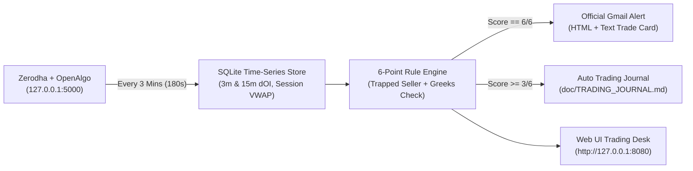

# LearnOT — Nifty & BankNifty Option Buying System (OpenAlgo + Zerodha)

> **Intraday NSE/BSE Index Option Buying System (`NIFTY`, `BANKNIFTY`, `SENSEX`) powered by [OpenAlgo](https://openalgo.in/) & Zerodha.**  
> Features a **3-minute Open Interest & Greeks analyzer**, **4-Quadrant Trapped-Seller detector**, **6-point mechanical checklist**, **Anti-Theta / Anti-IV-Crush guardrails**, **Zero-dependency Web UI trading desk**, **Official Gmail trade alerts**, and an **automated fine-tuning trading journal (`Score >= 3/6`)**.

---

## System Architecture



---

## Core Features

1. **3-Minute (`180s`) NSE Open Interest Engine (`option_chain_analyzer.py`)**
   * Aligned with NSE's exact **3-minute Open Interest broadcast cycle (`180s`)**.
   * Dynamically discovers nearest NFO/BFO expiry and computes **`3m dOI`**, **`15m dOI`**, **Spot & Option Session VWAP**, **Put-Call Parity Synthetic Future Basis**, and **ATM Straddle Decay %**.
   * Includes a **Market Hours Smart Guard (`09:15 AM – 03:30 PM IST`, Mon–Fri)** so after-hours frozen quotes never dilute your database or journal.
2. **4-Quadrant Price + OI Matrix**
   * Classifies every Call and Put strike into:
     * **`SHORT_COVERING`** *(Price $\uparrow$, OI $\downarrow$ — Trapped Option Sellers panicking: Your #1 Option Buying Edge)*
     * **`LONG_BUILDUP`** *(Price $\uparrow$, OI $\uparrow$ — Fresh Option Buyers)*
     * **`SHORT_BUILDUP`** *(Price $\downarrow$, OI $\uparrow$ — Institutional Option Writers building support/resistance walls)*
     * **`LONG_UNWINDING`** *(Price $\downarrow$, OI $\downarrow$ — Buyers exiting)*
3. **6-Point Mechanical "Trapped Seller Gamma Blast" Checklist**
   * Scores both **ATM Call (`CE`)** and **ATM Put (`PE`)** from `0/6` to `6/6`:
     1. **Spot & Synthetic Future Trend** ($\text{Spot} \ge \text{VWAP}$, stable Basis)
     2. **Option Premium Momentum** ($\text{Option LTP} > \text{Option Session VWAP}$)
     3. **Trapped Writers & 15m $\Delta\text{OI}$ Dominance** (Opposite side writing support + target side `SHORT_COVERING`)
     4. **Volume Burst & Order Flow** ($\text{Vol Ratio} \ge 1.30\times$ average)
     5. **Anti-IV-Crush Guardrail** (IV stable/expanding, ATM Straddle not collapsing)
     6. **Greeks & Anti-Theta Filter** ($\text{Delta} \in [0.45, 0.70]$, daily $|\Theta|/\text{LTP} \le 18\%$)
4. **Instant Official Gmail Setup Alerts (`smtp.gmail.com:465`)**
   * Fires a high-priority **HTML + Plain-Text Trade Card** to your Gmail when `6/6` rules align, complete with **Entry LTP**, **Hard Stop-Loss ($-18\%$)**, **Targets ($+25\%$ / $+45\%$)**, and **15-Minute Anti-Theta Time-Stop**.
5. **Automated Fine-Tuning Trading Journal (`Score >= 3/6`)**
   * Whenever **at least 3 out of 6 conditions (`3/6`, `4/6`, `5/6`, or `6/6`)** are met, automatically logs to [`doc/TRADING_JOURNAL.md`](doc/TRADING_JOURNAL.md) and [`doc/trading_journal.csv`](doc/trading_journal.csv):
     * **✅ What Was Good Today:** Exact conditions that passed.
     * **❌ Why It Did Not Meet 6/6:** Exact conditions that failed (e.g., PCR, Volume Burst, VWAP) with live numbers.
     * **📈 Forward Outcome Tracking:** Tracks how high the option moved *after* the signal (`Max LTP After` & `Max Gain %`) and flags **`MISSED WINNER`** vs. **`FILTER SAVED LOSS`** so you know which rule threshold to fine-tune.
6. **Zero-Dependency Web UI Trading Desk (`dashboard_ui.py`)**
   * Runs at **`http://127.0.0.1:8080`** with Live Option Chain, 6-Point Scorecards, OI Wall Bars, Gmail Alert Preview, Setup Journal Table, and Practice Trade Log with automatic **15-Minute Anti-Theta Time-Stop** tracking.

---

## Project Structure & Documentation

```text
LearnOT/
├── README.md                           # Project overview & quick-start guide
├── STRATEGY_BLUEPRINT_AND_RULEBOOK.md  # Complete Option Buying Strategy & Daily Rulebook
├── option_chain_analyzer.py            # Core 3-Min Option Chain Analyzer, Signal Engine, Journal & Gmail Notifier
├── dashboard_ui.py                     # Zero-dependency Web UI Trading Desk (http://127.0.0.1:8080)
├── pyproject.toml                      # uv project configuration (Python >= 3.9)
├── .env.example                        # Safe template for OpenAlgo API Key & Gmail App Password
├── .gitignore                          # Protects .env secrets and local SQLite .db files from Git
└── doc/
    ├── HOW_IT_WORKS.md                 # Detailed architecture & step-by-step workflow explanation
    ├── TRADING_JOURNAL.md              # Auto-updated Daily Trading & Fine-Tuning Journal (>= 3/6 setups)
    └── trading_journal.csv             # CSV export for Excel / Pandas fine-tuning analysis
```

* 📖 **[Strategy Blueprint & Daily Rulebook](STRATEGY_BLUEPRINT_AND_RULEBOOK.md)**
* ⚙️ **[How It Works — Full Architecture & Workflow Guide](doc/HOW_IT_WORKS.md)**
* 📓 **[Daily Trading & Fine-Tuning Journal (`Score >= 3/6`)](doc/TRADING_JOURNAL.md)**

---

## Prerequisite: How to Setup OpenAlgo ([https://openalgo.in/](https://openalgo.in/))

**LearnOT** uses **[OpenAlgo](https://openalgo.in/)** ([GitHub](https://github.com/marketcalls/openalgo) | [Official Docs](https://docs.openalgo.in/)) as its local API gateway (`http://127.0.0.1:5000`) to fetch live Option Chains, Greeks, and Synthetic Futures and to place simulated/live orders via **Zerodha** (or any of the 20+ Indian brokers supported by OpenAlgo such as Dhan, AngelOne, Fyers, Upstox, Flattrade, Shoonya).

> **Note:** Even if you don't have OpenAlgo installed yet, you can still run LearnOT immediately in **Practice Simulator (`--demo`) Mode**! Follow the steps below when you are ready to connect live market data.

### Step 1: Install `uv` (Fast Python Package Manager)
```bash
# macOS / Linux:
curl -LsSf https://astral.sh/uv/install.sh | sh

# Windows (PowerShell):
powershell -ExecutionPolicy ByPass -c "irm https://astral.sh/uv/install.ps1 | iex"
```

### Step 2: Clone & Install OpenAlgo (In a Separate Folder)
```bash
git clone https://github.com/marketcalls/openalgo.git
cd openalgo
cp .sample.env .env
```

### Step 3: Connect Your Broker (e.g., Zerodha Kite Connect) in OpenAlgo's `.env`
1. Create a developer app on [Zerodha Kite Connect (`developers.kite.trade`)](https://developers.kite.trade/) (or your preferred broker's API portal).
2. Set the **Redirect URL** in your broker portal to:
   ```text
   http://127.0.0.1:5000/zerodha/callback
   ```
3. Open `openalgo/.env` and fill in your broker credentials:
   ```ini
   BROKER_API_KEY=your_zerodha_kite_api_key
   BROKER_API_SECRET=your_zerodha_kite_api_secret
   REDIRECT_URL=http://127.0.0.1:5000/zerodha/callback
   ```

### Step 4: Launch OpenAlgo & Get Your `OPENALGO_API_KEY`
1. Start the OpenAlgo server:
   ```bash
   uv run app.py
   ```
2. Open **`http://127.0.0.1:5000`** in your browser, create your local OpenAlgo admin account, and click **Login with Broker** to authenticate with Zerodha for the day.
3. Toggle **Analyze Mode = ON** in the OpenAlgo navbar (this keeps OpenAlgo in safe **Paper/Simulator Mode** so no real money is risked while practicing).
4. Navigate to **`http://127.0.0.1:5000/apikey`** (or **Settings → API Key**), generate your **OpenAlgo API Key**, and copy it for the next section!

---

## Quick Start: Running LearnOT (Using `uv`)

### 1. Clone LearnOT & Configure Your `.env` File (Protected by `.gitignore`)
```bash
git clone https://github.com/RangasamyArran/riskrewardzone.git
cd riskrewardzone
cp .env.example .env
```
Edit `.env` and fill in your credentials *(Note: `.env` is listed in [`.gitignore`](.gitignore) so your API keys and passwords will **never** be committed to Git)*:
* `OPENALGO_HOST=http://127.0.0.1:5000`
* `OPENALGO_API_KEY`: Paste the API key you copied from `http://127.0.0.1:5000/apikey`
* `GMAIL_USER`: Your Gmail address (`your_email@gmail.com`)
* `GMAIL_APP_PASSWORD`: Your 16-character Google App Password from [myaccount.google.com/apppasswords](https://myaccount.google.com/apppasswords)

### 2. Launch the Web UI Trading Desk
```bash
uv run dashboard_ui.py --port 8080
```
Open **`http://127.0.0.1:8080`** in your browser:
* Use **Practice Simulator (Demo)** mode 24/7 (even on weekends/nights) to step through scenarios without needing OpenAlgo running.
* Switch to **Live OpenAlgo (`127.0.0.1:5000`)** during market hours (`09:15 AM – 03:30 PM IST`) with **Auto-Poll set to `180s (3m NSE OI Cycle ★)`**.

### 3. Run From Terminal (CLI)
```bash
# Run 3-step Trapped-Seller Simulation + Gmail Alert + Journal Test (works 24/7 without OpenAlgo):
uv run option_chain_analyzer.py --test-email

# Run Live 3-Minute Option Chain Analyzer during market hours (09:15 AM - 03:30 PM IST):
uv run option_chain_analyzer.py --underlying NIFTY --interval 180 --auto-paper
```

