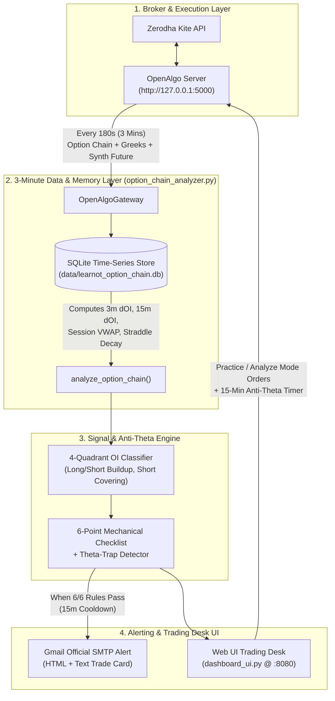

# How LearnOT Works: Architecture, Option Chain Engine & Trading Workflow

This document explains how the **LearnOT Option Buying System** works from end to end—how it connects to **Zerodha via OpenAlgo**, why it collects data on a **3-minute (`180s`) cycle**, how it detects **Trapped Option Sellers (Gamma Squeezes)** while blocking **Theta Decay & IV Crush**, and how it alerts you on **Gmail** and manages your practice/simulated trades.

---

## 1. High-Level System Architecture



---

## 2. Core Philosophy: Why This System Exists

In Indian Index Options (**NIFTY**, **BANKNIFTY**, **SENSEX**), option buyers face two mathematical enemies:
1. **Theta Decay ($\Theta$):** Every minute the market stays sideways, your option premium melts.
2. **IV Crush (Vega Risk):** If Implied Volatility drops after you buy, your option loses value even if the index moves in your direction.

### How LearnOT Flips the Edge in Your Favor
Instead of guessing market direction from price candles alone, LearnOT tracks **Institutional Option Writers (Sellers)** who have ₹1.5L+ margin per lot on the line:
* When Option Sellers aggressively write Puts (`SHORT_BUILDUP` on PE) **and** trapped Call Sellers are forced to buy back their losing positions (`SHORT_COVERING` on CE) with a **Volume Burst** and **rising IV**, their forced buying creates a violent, fast **Gamma Squeeze**.
* You only enter **ATM Options** during that explosive window—and if the move doesn't happen within **15 minutes**, the system forces a **Time-Stop Exit** before Theta can hurt you.

---

## 3. Step-by-Step Pipeline Breakdown

### Step 1: OpenAlgo Connection & Safety Guard (`OpenAlgoGateway`)
Located in [`option_chain_analyzer.py`](../option_chain_analyzer.py):
1. **Safety Check (`/api/v1/analyzer`):** Before doing anything, the system queries OpenAlgo to check if **`analyze_mode` (Simulator Mode)** is `ON` or `OFF`. It refuses to auto-place practice orders if OpenAlgo is accidentally left in Live Broker mode.
2. **Dynamic Expiry Discovery (`/api/v1/expiry`):** Never hardcodes expiry dates. It fetches the official NFO/BFO calendar and picks the nearest active weekly/monthly expiry and computes `days_to_expiry`.
3. **Unified Snapshot Fetch (`/api/v1/optionchain` & `/api/v1/syntheticfuture`):** Pulls the live Spot LTP, Synthetic Future fair value, and `±5` strikes around ATM including **LTP, Bid/Ask Qty, Volume, Open Interest (OI), Implied Volatility (IV), Delta, Gamma, Theta, and Vega**.

---

### Step 2: Why 3-Minute (`180s`) Data Collection & SQLite Memory (`SnapshotStore`)
A static option chain only shows *total* cumulative Open Interest since contract inception—which can mislead intraday traders. You need **intraday change in OI ($\Delta\text{OI}$)**.

* **Why 3 Minutes (`180s`)?**
  While Zerodha streams Price (LTP) and Volume every second, the **NSE Exchange broadcasts Open Interest updates on a 3-minute (`180s`) cycle**. Polling every 180 seconds ensures every snapshot captures fresh exchange OI data without false `dOI = 0` readings.
* **What SQLite Calculates on Every Snapshot:**
  * **`doi_3m` (`180s` lookback):** Fresh 1-cycle Open Interest surge (who is entering or panicking *right now*).
  * **`doi_15m` (`900s` lookback):** 5-cycle structural trend battle between Call Writers and Put Writers around ATM.
  * **Session VWAP (Spot & Option):** Computes intraday Volume-Weighted Average Price from snapshot deltas so you never buy an option trading below its own session average.
  * **ATM Straddle Decay (`straddle_change_pct`):** Compares current `ATM CE + ATM PE` combined premium against the morning opening straddle to detect if institutional straddle sellers are crushing premiums.

---

### Step 3: The 4-Quadrant Price + OI Matrix (`classify_quadrant`)
For every Call and Put strike, the engine compares **3-minute Price change ($\Delta\text{LTP}$)** and **3-minute OI change ($\Delta\text{OI}$)**:

| Quadrant Label | 3-Min Price ($\Delta\text{LTP}$) | 3-Min OI ($\Delta\text{OI}$) | Who Is In Control? | Meaning for Option Buyers |
| :--- | :--- | :--- | :--- | :--- |
| **`SHORT_COVERING`** | **Rising ($\uparrow$)** | **Falling ($\downarrow$)** | **Trapped Option Sellers Panicking** | **#1 Best Trigger to BUY this option** (writers forced to buy back at market) |
| **`LONG_BUILDUP`** | **Rising ($\uparrow$)** | **Rising ($\uparrow$)** | Fresh Option Buyers Entering | **Strong Momentum Confirmation** |
| **`SHORT_BUILDUP`** | **Falling ($\downarrow$)** | **Rising ($\uparrow$)** | **Aggressive Option Writers Selling** | **Strong Floor/Ceiling** (e.g., Put `SHORT_BUILDUP` supports buying Calls) |
| **`LONG_UNWINDING`** | **Falling ($\downarrow$)** | **Falling ($\downarrow$)** | Buyers Booking/Exiting | **Exhaustion — Stay Out** |

---

### Step 4: The 6-Point Mechanical Checklist (`evaluate_6_point_checklist`)
To eliminate emotional trading, the engine scores **Bullish ATM Call (`CE`)** and **Bearish ATM Put (`PE`)** from `0/6` to `6/6`. A trade signal triggers **only when all 6 rules pass (`6/6`)**:

| # | Rule Name | Bullish `BUY_ATM_CE` Condition | Bearish `BUY_ATM_PE` Condition | Why It Matters |
| :--- | :--- | :--- | :--- | :--- |
| **1** | **Underlying & Synthetic Trend** | $\text{Spot LTP} \ge \text{Spot VWAP}$ and $\text{Basis} \ge -5$ | $\text{Spot LTP} \le \text{Spot VWAP}$ and $\text{Basis} \le +5$ | Aligns trade with institutional Futures order flow |
| **2** | **Option Premium Momentum** | $\text{ATM CE LTP} > \text{CE Session VWAP}$ & $\Delta\text{LTP}_{3m} > 0$ | $\text{ATM PE LTP} > \text{PE Session VWAP}$ & $\Delta\text{LTP}_{3m} > 0$ | Confirms real option demand, not a dead-cat bounce |
| **3** | **Trapped Writers / 15m $\Delta\text{OI}$** | $15\text{m PE }\Delta\text{OI} > \text{CE }\Delta\text{OI}$ and ATM CE in `SHORT_COVERING` / `LONG_BUILDUP` | $15\text{m CE }\Delta\text{OI} > \text{PE }\Delta\text{OI}$ and ATM PE in `SHORT_COVERING` / `LONG_BUILDUP` | Ensures trapped option writers are fueling your move |
| **4** | **Volume Burst & Order Book** | $\text{Vol Ratio} \ge 1.3\times$ (or $\text{BidQty} \ge \text{AskQty}$ with rising LTP) | $\text{Vol Ratio} \ge 1.3\times$ (or $\text{BidQty} \ge \text{AskQty}$ with rising LTP) | Confirms institutional participation on the current bar |
| **5** | **Anti-IV-Crush Guardrail** | ATM CE $\text{IV}$ stable/expanding ($\Delta\text{IV}_{3m} \ge -0.3\%$) & Straddle not collapsing | ATM PE $\text{IV}$ stable/expanding ($\Delta\text{IV}_{3m} \ge -0.3\%$) & Straddle not collapsing | Prevents buying right into a volatility crush |
| **6** | **Greeks & Anti-Theta Filter** | $\text{Delta} \in [0.45, 0.70]$ and Daily $|\Theta| / \text{LTP} \le 18\%$ | $|\text{Delta}| \in [0.45, 0.70]$ and Daily $|\Theta| / \text{LTP} \le 18\%$ | Blocks low-Delta OTM lottery tickets & high-Theta traps |

> [!WARNING]
> **Automatic Theta-Trap Blocker (`THETA_TRAP_NO_TRADE`):**
> If the ATM Straddle has decayed by more than **$-2.5\%$** since the morning open while *both* Call Writers and Put Writers are adding Open Interest ($15\text{m CE }\Delta\text{OI} > 0$ and $15\text{m PE }\Delta\text{OI} > 0$), the engine overrides all signals and displays **`THETA_TRAP_NO_TRADE`**.

---

### Step 5: Instant Gmail Trade Setup Alerts (`WhatsAppNotifier`)
Whenever a `6/6` signal fires (`BUY_ATM_CE` or `BUY_ATM_PE`):
1. **Deduplication Cooldown:** Checks the `whatsapp_alerts` SQLite table to ensure you haven't already been alerted on the same contract within the last **15 minutes (`900s`)**.
2. **Rich Trade Card Formatting:** Generates both a plain-text summary ([`format_whatsapp_setup_message`](../option_chain_analyzer.py)) and a styled dark-mode HTML email ([`format_email_html_setup_message`](../option_chain_analyzer.py)) containing:
   * Exact Contract Symbol & Lot Size (e.g., `NIFTY05NOV2624500CE`, Lot `65`)
   * **Entry LTP**, **Hard Stop-Loss ($-18\%$)**, **Target 1 ($+25\%$)**, **Target 2 ($+45\%$)**, and **15-Minute Anti-Theta Time-Stop price ($+5\%$)**
   * Full 3-Min Option Chain metrics (Spot vs VWAP, Straddle %, Quadrant, 3m/15m $\Delta\text{OI}$, PCR, IV, Delta, Theta bleed %)
   * Full 6/6 Checklist breakdown table
3. **Direct Official Delivery:** Connects directly from your Mac to `smtp.gmail.com:465` over SSL using your 16-character Google App Password and delivers the alert to your inbox with high-priority headers (`X-Priority: 1`).

---

### Step 6: Practice Execution & 15-Minute Anti-Theta Exit Engine (`dashboard_ui.py`)
When you click **`+ Practice Buy ATM CE/PE`** in the Web UI (or run `--auto-paper` in the CLI):
1. If connected to OpenAlgo in **Analyze Mode**, it routes a simulated order to `/api/v1/optionsorder` and records the trade in the `paper_trades` SQLite table.
2. On every subsequent refresh, [`_update_open_paper_trades`](../dashboard_ui.py) marks your trade to market (MTM PnL in Points and ₹) and automatically closes the trade if any of the **4 mechanical exit rules** hit:
   * **`HARD_STOP_LOSS (-18%)`:** Current LTP drops $\le \text{Entry} \times 0.82$.
   * **`TARGET_1_HIT (+25%)`:** Current LTP reaches $\ge \text{Entry} \times 1.25$.
   * **`TARGET_2_HIT (+45%)`:** Current LTP reaches $\ge \text{Entry} \times 1.45$.
   * **`THETA_TIME_STOP (15m < +5%)`:** Trade has been open for $\ge 15\text{ minutes}$ and current LTP is still $< \text{Entry} \times 1.05$.

---

### Step 7: The Setup & Fine-Tuning Journal (`Score >= 3/6`)
Located in [`update_and_write_setup_journal`](../option_chain_analyzer.py):
* **Why It Exists:** Often 4 or 5 conditions are met (e.g., Trend, VWAP, IV, and Greeks all pass, while only **PCR/dOI** or **Volume Burst** fails). If that option goes on to rally $+20\%$, you want to know *which specific rule blocked you* so you can fine-tune that threshold based on real market data.
* **How It Works Automatically:**
  1. **Logs All `>= 3/6` Setups:** Whenever either ATM CE or ATM PE scores **3/6, 4/6, 5/6, or 6/6**, the engine records the entry in the `setup_journal` SQLite table and writes to [`doc/TRADING_JOURNAL.md`](TRADING_JOURNAL.md), `doc/trading_journal_<YYYY-MM-DD>.md`, and [`doc/trading_journal.csv`](trading_journal.csv).
  2. **Records "What Was Good Today" vs. "Why It Did Not Meet 6/6":** Each entry explicitly lists all passed conditions alongside the exact rule(s) that failed and their live metric values (e.g., `R3: Trapped Writers / PCR / dOI [PCR 0.89]` or `R4: Volume Burst [Vol Ratio 1.00x]`).
  3. **Tracks Forward Outcome (`Max LTP After` & `Max Gain %`):** As new 3-minute snapshots arrive during the session, the journal automatically updates how high that option's LTP climbed *after* the journal entry and assigns an automatic verdict:
     * **`MISSED WINNER (+XX% -> Tune Missing Rule!)`:** If a `3/6`–`5/6` near-miss rallied $\ge +12\%$ afterward.
     * **`FILTER SAVED LOSS (-XX%)`:** If a `3/6`–`5/6` setup dropped $\le -10\%$ without rallying—proving the missing rule protected your capital!
  4. **Rule-Blocker Leaderboard:** Summarizes at the top of the journal (and in the Web UI) how many winning moves each rule (`R1`–`R6`) blocked today and recommends whether to relax or keep that rule.

---

## 4. Project File Map

```text
LearnOT/
├── STRATEGY_BLUEPRINT_AND_RULEBOOK.md  # Complete Option Buying Strategy & Daily Rulebook
├── option_chain_analyzer.py            # Core 3-Min Option Chain Analyzer, Signal Engine, Journal & Gmail Notifier
├── dashboard_ui.py                     # Zero-dependency Web UI Trading Desk (http://127.0.0.1:8080)
├── pyproject.toml                      # uv project configuration (Python >= 3.9, zero external packages needed)
├── .env.example                        # Template for OpenAlgo API Key, 180s Poll Interval & Gmail App Password
├── doc/
│   ├── HOW_IT_WORKS.md                 # This architecture & workflow guide
│   ├── TRADING_JOURNAL.md              # Auto-updated Daily Trading & Fine-Tuning Journal (all >= 3/6 setups)
│   ├── trading_journal_YYYY-MM-DD.md   # Daily archived Markdown Trading Journal
│   └── trading_journal.csv             # CSV export for Excel / Pandas fine-tuning analysis
└── data/
    └── learnot_option_chain.db         # Auto-created SQLite database storing 3m snapshots, journal & trades
```

---

## 5. Quick-Start & Daily Commands (`uv`)

### A. First-Time Setup (One Time Only)
1. Copy `.env.example` to `.env`:
   ```bash
   cp .env.example .env
   ```
2. Edit `.env` and fill in:
   * `OPENALGO_API_KEY`: Your API key from `http://127.0.0.1:5000/apikey`
   * `GMAIL_USER`: Your Gmail address (`your_email@gmail.com`)
   * `GMAIL_APP_PASSWORD`: Your 16-character Google App Password from [myaccount.google.com/apppasswords](https://myaccount.google.com/apppasswords)

### B. Test the Simulation & Gmail Alert Anytime (Even When Market is Closed)
```bash
uv run option_chain_analyzer.py --test-email
```
*Runs a 3-step realistic Trapped-Seller simulation (09:30 -> 09:33 -> 09:36 AM), triggers a `6/6 BUY_ATM_CE` Gamma Blast, and sends/previews the Gmail alert.*

### C. Launch the Interactive Web UI Trading Desk (Recommended Daily Workflow)
```bash
uv run dashboard_ui.py --port 8080
```
* Open **`http://127.0.0.1:8080`** in your browser.
* Use **Practice Simulator (Demo)** to step through scenarios, or switch to **Live OpenAlgo (`127.0.0.1:5000`)** during market hours (`9:15 AM – 3:30 PM`) with **Auto-Poll set to `180s (3m NSE OI Cycle ★)`**.

### D. Run Headless Terminal Analyzer During Market Hours
```bash
uv run option_chain_analyzer.py --underlying NIFTY --interval 180 --auto-paper
```
*Polls NIFTY every 3 minutes, prints the live Option Chain & 6-Point Scorecard in the terminal, emails you on Gmail whenever a `6/6` setup triggers, and logs simulated trades in OpenAlgo Analyze Mode.*
